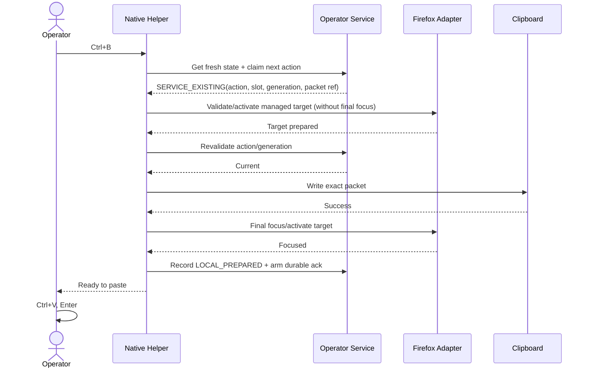
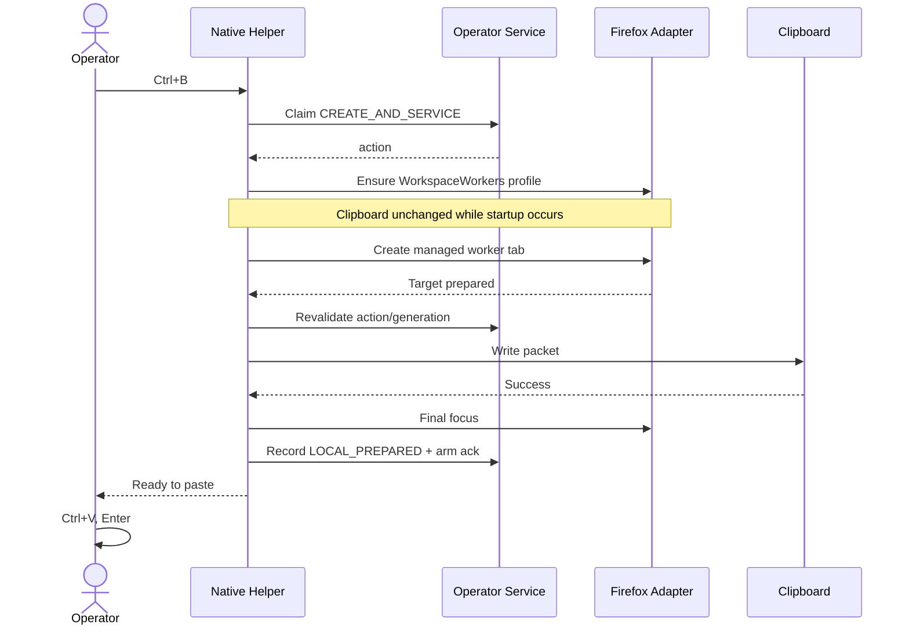
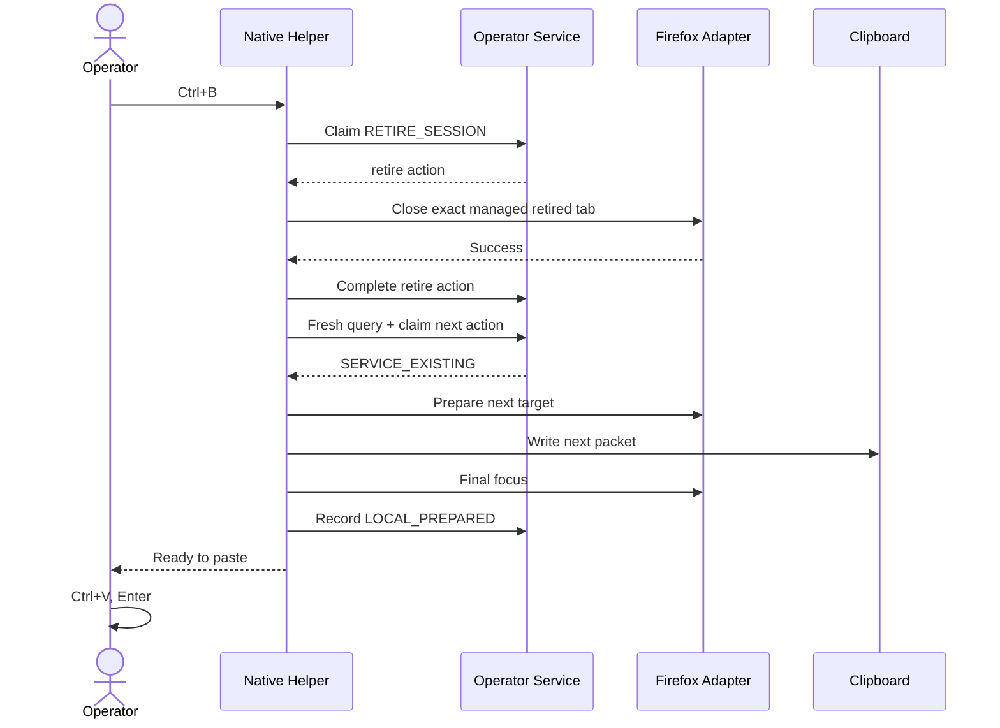
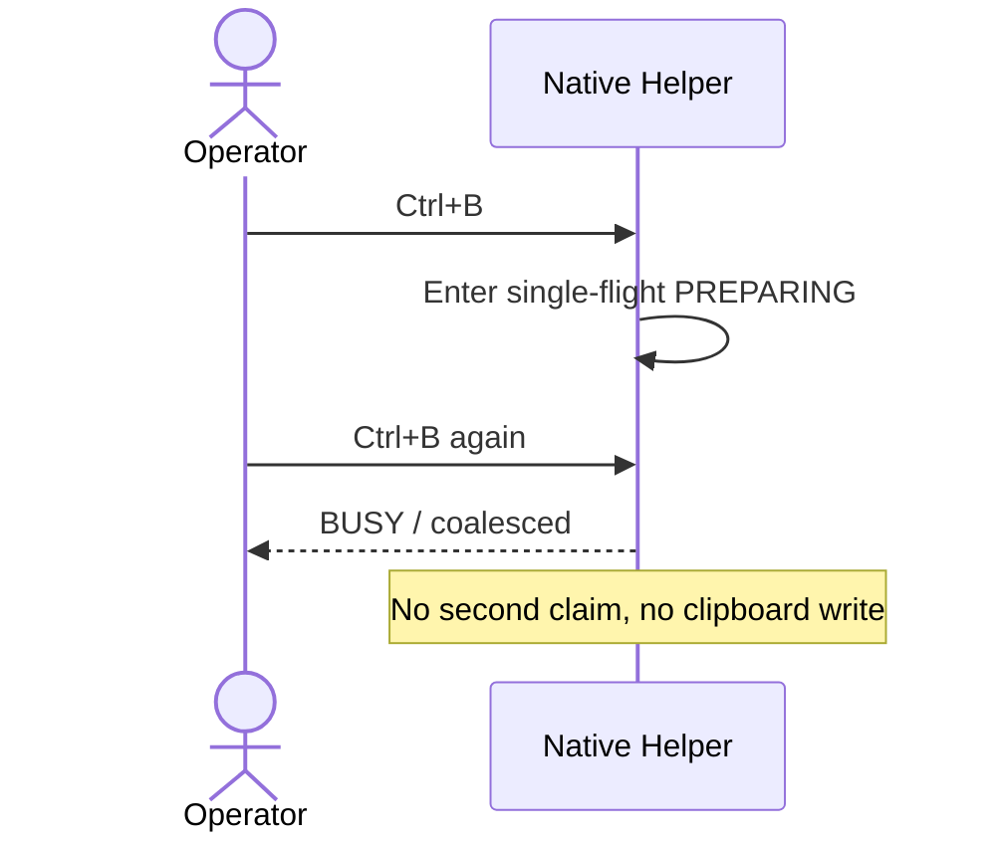
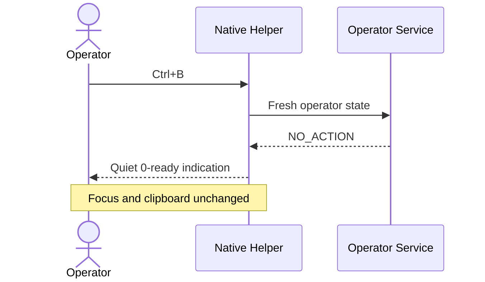

# Workspace Semantic Execution Hotkey Dispatch Sequences v0.1

Status: **UX-05 DESIGN CANDIDATE**

## Routine existing-worker service

## Cold Firefox create-and-service

## Local-only maintenance then service

## Second Ctrl+B while first dispatch is still preparing

## No work

