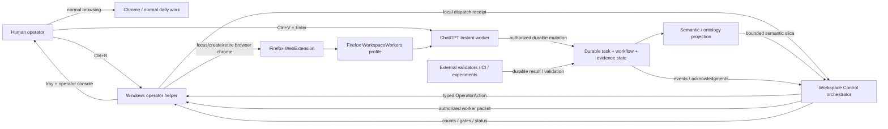
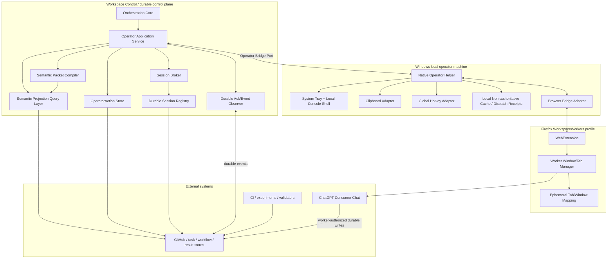

# Workspace Semantic Execution Operator System Context v0.1

Status: **UX-02 ARCHITECTURE BASELINE / DESIGN CANDIDATE**

Parent task: `workspace-semantic-execution-migration-v1`

Companions:
- `architecture/workspace-semantic-execution-operator-ux-requirements.v0.1.md`
- `architecture/workspace-semantic-execution-operator-journeys.v0.1.md`
- `architecture/workspace-semantic-execution-operator-interface-ownership.v0.1.json`
- `architecture/workspace-semantic-execution-operator-adr-native-helper-firefox-split.v0.1.md`
- `architecture/workspace-semantic-execution-operator-adr-dedicated-firefox-profile.v0.1.md`
- `architecture/workspace-semantic-execution-operator-adr-durable-state-local-cache.v0.1.md`

## 1. Architectural objective

Create a replaceable human-operated Chat Instant adapter whose routine operator experience is:

```text
Ctrl+B
Ctrl+V
Enter
```

without allowing browser-local state, semantic inference, or UI automation to become workflow authority.

The operator subsystem is an adapter around the Workspace Control orchestration core. It does not own task truth, semantic truth, execution authority, or worker completion.

## 2. Architectural style

UX-02 adopts:

- hexagonal / ports-and-adapters architecture;
- dependency inversion;
- command-query separation;
- single-writer ownership for each state class;
- event-driven durable acknowledgment;
- least privilege;
- fail-closed unknown state;
- explicit replaceability of browser/platform adapters.

Core rule:

> Platform adapters depend on application/core contracts. Core contracts do not depend on Firefox, Windows, ChatGPT, clipboard APIs, or GitHub SDK details.

## 3. System context



### Trust interpretation

- `DS` is authoritative only for the fact classes owned by the underlying task/workflow/project sources.
- `SG` is a rebuildable semantic projection/read model.
- `WC` owns orchestration transitions, eligibility/routing results, and OperatorAction lifecycle under existing authority.
- `NH` and `EXT` are local execution adapters.
- `CG` is a reasoning executor, not an authority source merely because it produced text.
- `H` is required for manual paste/submit and genuine judgment/authority gates.

## 4. Container/process view



Transport choices between these boxes remain intentionally unfrozen until UX-12.

## 5. Component responsibilities

### 5.1 Orchestration Core

Owns:
- work eligibility;
- authority filtering;
- deterministic task/process transitions;
- routing decisions;
- stale-generation rejection;
- event/wait semantics;
- validator gates.

Does not own:
- browser state;
- clipboard;
- hotkeys;
- UI rendering;
- ChatGPT page state.

### 5.2 Operator Application Service

Owns application use cases:
- `GetOperatorStatus`
- `GetNextOperatorAction`
- `ClaimOperatorAction`
- `RecordLocalDispatch`
- `RecordDurableAcknowledgment`
- `ResolveOperatorGate`
- `RequestSessionRecovery`

It is the sole bridge between local operator adapters and core/session services.

### 5.3 Semantic Projection Query Layer

Owns rebuildable queries such as:
- current objective;
- unresolved questions;
- dependencies/blockers;
- evidence refs;
- authority refs;
- executor capability requirements.

It cannot grant permission.

### 5.4 Semantic Packet Compiler

Produces the exact bounded worker packet from:
- ReasoningProcess identity;
- semantic projection;
- durable evidence refs;
- inherited constraints;
- authority/gate refs;
- validator/output contract.

It does not select a browser tab.

### 5.5 Session Broker

Owns **logical session intent and policy**:
- logical worker slot;
- generation;
- role;
- task/process affinity;
- executor requirement;
- continuity classification;
- reuse/rotate/create/retire decision;
- context/session policy.

It does not own Firefox `tabId` or `windowId`.

### 5.6 Durable Session Registry

Owns durable logical session records required for recovery.

May contain:
- slot ID;
- generation;
- executor requirement;
- process affinity;
- continuity state;
- last acknowledged durable checkpoint;
- lifecycle intent.

Must not contain browser-local tab identifiers as authoritative identity.

### 5.7 OperatorAction Store

Owns the durable lifecycle of typed manual actions:
- queued;
- claimed;
- local-prepared;
- sent/unconfirmed;
- acknowledged;
- completed;
- stale/superseded/blocked.

### 5.8 Durable Ack/Event Observer

Observes authoritative durable state and emits application events.

It is the only mechanism that may convert a locally prepared manual dispatch into a durably acknowledged worker action.

No ChatGPT DOM/page completion inference is permitted.

### 5.9 Native Operator Helper

Owns local machine concerns:
- global hotkey registration;
- master ON/OFF toggle;
- clipboard write;
- system tray;
- local console shell;
- local dispatch receipts/cache;
- browser-bridge invocation;
- local notifications.

Does not own:
- scheduler order;
- worker compatibility;
- task authority;
- durable completion.

### 5.10 Firefox WebExtension

Owns browser-chrome concerns only:
- identify dedicated worker profile/window context;
- create/activate/remove/discard/reload worker tabs;
- report browser operation results;
- maintain/recover ephemeral browser mappings.

It MUST NOT:
- read ChatGPT conversation text;
- inject messages;
- click Send;
- infer worker completion.

### 5.11 Human Operator

Owns:
- explicit activation of routine service through Ctrl+B;
- manual Ctrl+V + Enter in ChatGPT;
- unavoidable authentication interaction;
- substantive judgment/authority decisions.

Does not own:
- scheduler routing;
- session selection;
- tab identification;
- durable-state relay.

### 5.12 ChatGPT Instant Worker

Owns one bounded reasoning quantum under its worker contract.

It may write only through already-authorized durable tool surfaces.

Its output is not automatically equivalent to execution authority or validation.

## 6. State ownership model

### Durable authoritative/control state

Owned outside local browser/helper:
- task/workflow state;
- ReasoningProcess state;
- evidence/provenance;
- authority refs/decisions;
- OperatorAction lifecycle;
- logical session slot/generation;
- routing decision;
- durable worker acknowledgment;
- validation state;
- semantic source assertions.

### Rebuildable semantic state

Owned as projection/read model:
- semantic graph edges;
- bounded context slices;
- current-view supersession projections;
- derived readiness/context queries.

Rebuildable from authoritative sources.

### Local non-authoritative state

Owned by Windows/Firefox adapters:
- Firefox process health;
- extension connection state;
- current `windowId`;
- current `tabId`;
- local slot-to-tab binding cache;
- clipboard write result;
- hotkey registration state;
- tray presentation state;
- local dispatch timestamps/receipts.

Loss of local state must degrade convenience, not correctness.

## 7. Command-query separation

### Queries

Safe/read-only examples:
- `GetOperatorStatus`
- `GetReadyManualCycleCount`
- `GetActionPreview`
- `GetSessionRecoveryStatus`

Queries do not claim work.

### Commands

State-changing examples:
- `ClaimNextOperatorAction`
- `RecordLocalPrepared`
- `RecordBrowserOperationFailure`
- `RequestSessionRecovery`
- `ResolveJudgmentGate`

A Ctrl+B routine dispatch uses:
1. fresh query;
2. atomic claim command;
3. local browser/clipboard operations;
4. local dispatch receipt command.

## 8. Ports

Core/application-facing ports:

### OperatorBridgePort
Used by native helper to:
- fetch status;
- atomically claim next action;
- record local dispatch result;
- report local component failure/recovery.

### SessionRegistryPort
Used by session broker to read/write logical session lifecycle.

### SemanticContextPort
Used by packet compiler/router to query bounded semantic state.

### DurableAckPort
Used by application service to receive durable worker/event acknowledgments.

### BrowserPort
Implemented by Firefox-side adapter; operations are chrome-level only.

### ClipboardPort
Implemented locally; write-only for routine dispatch in v0.

### HotkeyPort
Implemented locally; register/unregister configured global command.

### NotificationPort
Implemented by tray/console adapter.

### TelemetryPort
Receives allowlisted UX measurements only.

### ClockPort
Abstract clock for deterministic timeout/measurement tests.

## 9. Cross-process interface rules

Every cross-process message MUST carry enough identity to reject stale/confused operations:

- protocol version;
- request/action ID;
- task ID when applicable;
- worker slot ID when applicable;
- generation;
- operation type;
- correlation ID;
- success/failure result;
- timestamp/monotonic observation where relevant.

Browser commands MUST identify logical slot + generation and never rely only on a raw tab ID.

Clipboard payloads SHOULD be passed by exact action-bound content/ref and SHOULD be hash-addressable for telemetry/provenance.

Concrete serialization/IPC transport is deferred to UX-12.

## 10. Restart/recovery boundaries

### Orchestrator restart
Recover from durable task/action/session state.

### Native helper restart
Re-query current operator state; local cache is disposable.

### Firefox/extension restart
Reinventory browser state; browser mappings are re-established or sessions become LOST/UNKNOWN.

### Chat/session continuity loss
Logical session policy decides rotate/recreate from durable checkpoint. No manual task reconstruction.

### Semantic projection loss
Rebuild projection from authoritative records.

No restart path may require reconstructing control truth from ChatGPT tab contents.

## 11. Replaceability matrix

The following substitutions must not require scheduler-core redesign:

- Firefox → another browser adapter;
- Windows helper → another OS helper;
- human Chat bridge → future supported machine Chat adapter;
- GPT-6 Instant → later calibrated Instant model;
- JSON/in-memory semantic projection → later graph/relational projection;
- local tray UI → alternate operator presentation.

Only adapters/contracts should change.

## 12. Architectural invariants

1. One state class has one authoritative owner.
2. Browser identifiers are never workflow authority.
3. Semantic projection cannot grant execution authority.
4. Local preparation cannot imply durable acknowledgment.
5. Platform adapters depend inward; domain/core never depends outward.
6. UI state is derived, not authoritative.
7. The human is not a message bus for durable state.
8. Chat session continuity is an optimization, not the continuity boundary.
9. Login refresh may destroy local continuity but not task progress.
10. Unknown session continuity fails closed.
11. Routine operator path remains one scheduler hotkey + Ctrl+V + Enter.
12. Future supported Chat automation can replace the human bridge without changing scheduler semantics.

## 13. UX-02 acceptance assessment

Responsibility and state ownership are explicit for:
- orchestration core;
- semantic projection;
- packet compiler;
- session broker;
- durable session registry;
- OperatorAction store;
- durable acknowledgment observer;
- native helper;
- tray/console;
- Firefox WebExtension;
- human operator;
- ChatGPT worker.

Dependency direction and replaceability are explicit.

The three key architectural decisions are recorded in companion ADRs.

