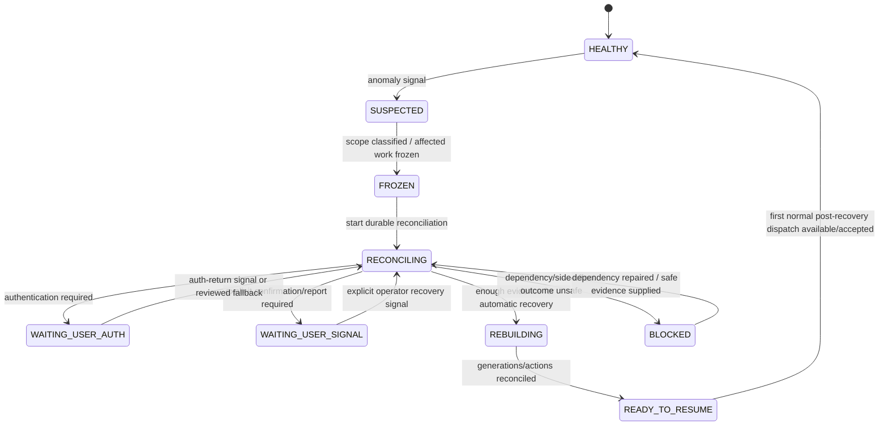
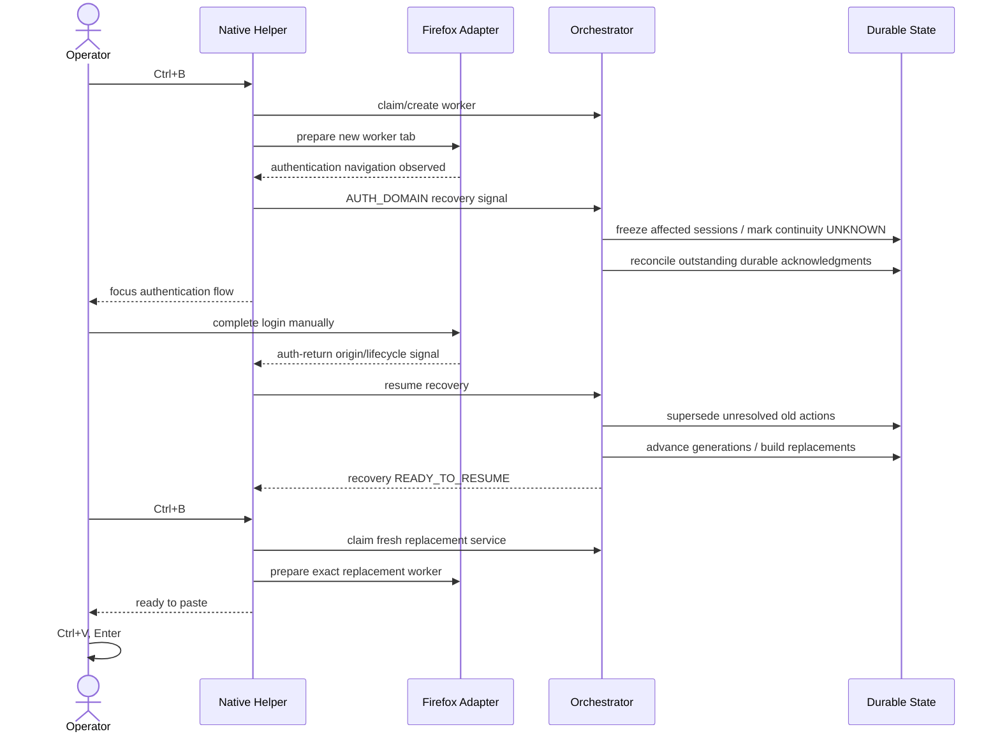

# Workspace Semantic Execution Recovery State Machine v0.1

Status: **UX-07 DESIGN CANDIDATE**

## Global recovery state



## Authentication refresh sequence



The auth-return browser signal never restores old sessions to TRUSTED. It merely allows reconciliation/rebuild to proceed.

## Scoped recovery rule

```text
if recovery.scope in [ACTION_SCOPED, SESSION_SCOPED]
and independent READY work exists:
    Ctrl+B may service independent READY work
else:
    Ctrl+B advances/focuses recovery
```

For `AUTH_DOMAIN_SCOPED` or `LOCAL_BRIDGE_GLOBAL` recovery, no Chat browser service is allowed until recovery reaches READY_TO_RESUME.

## Recovery idempotency

Recovery state is durable enough to survive helper restart:

```text
recovery_id
scope
affected_session_generations
trigger_signals
durable_reconciliation_checkpoint
completed_steps
next_safe_step
status
```

A repeated recovery command resumes the next incomplete step; it does not replay completed generation advances or supersessions.
