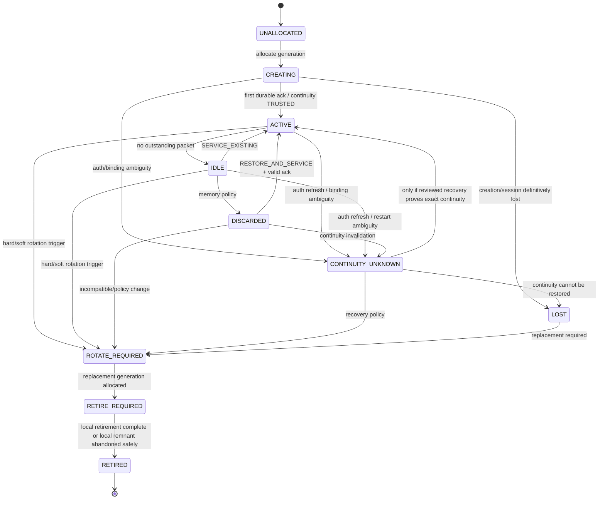

# Workspace Semantic Execution Session Lifecycle v0.1

Status: **UX-04 DESIGN CANDIDATE**



## Continuity overlay

Session lifecycle state and continuity state are separate axes.

- `CREATING + NOT_ESTABLISHED`: new generation awaiting first durable ack.
- `ACTIVE/IDLE/DISCARDED + TRUSTED`: reusable subject to compatibility.
- `CONTINUITY_UNKNOWN + UNKNOWN`: frozen; no reuse.
- `LOST + LOST`: replacement required.
- `RETIRED`: generation permanently closed.

A successful page load alone never changes UNKNOWN to TRUSTED.

## Generation transition

```text
slot instant-general-1 generation 7
        │ hard rotation
        ▼
generation 7 continuity UNKNOWN/LOST
        │ allocate replacement
        ▼
slot instant-general-1 generation 8 CREATING
        │ first valid durable ack
        ▼
generation 8 ACTIVE + TRUSTED
```

Generation 7 can never become current again.

